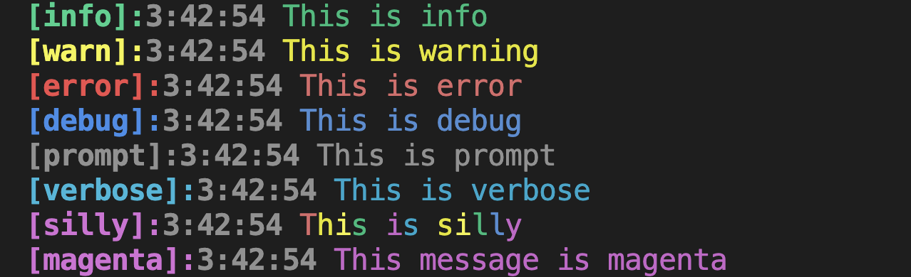

# ps-logger



 
- [](https://npmjs.com/package/ps-logger)

- <a href="https://dev.to/imshivanshpatel" target="blank"></a>
<a href="https://linkedin.com/in/shivansh-patel-4915b4171" target="blank"></a>
<a href="https://instagram.com/programming_updates" target="blank"></a>
- ps-logger is a production grade logger for info, warning, error, silly, verbose, prompt, debug, and magenta messages, with file logging and scrolling terminal text support.

## More Products to checkout

<table>
	<tr>
		<td width="50%">
			<a href="https://chromewebstore.google.com/detail/Timez%20Timer%20%26%20Pomodoro/jpbjkgabibfagbhklibkeblgedgkbgei?utm_source=ext_app_menu"></a><br />
			<strong><a href="https://chromewebstore.google.com/detail/Timez%20Timer%20%26%20Pomodoro/jpbjkgabibfagbhklibkeblgedgkbgei?utm_source=ext_app_menu">Timez Timer &amp; Pomodoro</a></strong><br />
			<sub>"Timez Timer & Pomodoro" is a Chrome extension designed to enhance focus and productivity. Set multiple timers within the extension to break down your tasks, manage your time effectively, and achieve your goals. Additionally, you can use the Pomodoro feature to work and have a break in a more planned way</sub><br /><br />
			<a href="https://chromewebstore.google.com/detail/Timez%20Timer%20%26%20Pomodoro/jpbjkgabibfagbhklibkeblgedgkbgei?utm_source=ext_app_menu"><strong>Open &rarr;</strong></a>
		</td>
		<td width="50%">
			<a href="https://chromewebstore.google.com/detail/syncboard-clipboard-manag/pjkhiifckihkopcgelghofikbhdijcke"></a><br />
			<strong><a href="https://chromewebstore.google.com/detail/syncboard-clipboard-manag/pjkhiifckihkopcgelghofikbhdijcke">Syncboard Clipboard Manager</a></strong><br />
			<sub>SyncBoard is a powerful clipboard management extension that seamlessly syncs your clipboard data across all your devices. Effortlessly copy, organize, and access your clipboard history anywhere, boosting your productivity and ensuring you never lose important information.</sub><br /><br />
			<a href="https://chromewebstore.google.com/detail/syncboard-clipboard-manag/pjkhiifckihkopcgelghofikbhdijcke"><strong>Open &rarr;</strong></a>
		</td>
	</tr>
</table>


## **`File logger`** added

#### usage examples:-

```JAVASCRIPT
const logger=require('ps-logger');

logger.info("This is info")
logger.warn("This is warning");
logger.error("This is error");
logger.debug("This is debug");
logger.prompt("This is prompt");
logger.verbose("This is verbose");
logger.silly("This is silly");
logger.magenta("This message is magenta");
```

#### Scrolling terminal text

Use `scrollingText` to continuously scroll text across the terminal. The optional second argument sets the text color to one of the available `colorsObj` keys.

```javascript
logger.scrollingText("Your server is running", "cyan");
```

Available colors are `red`, `yellow`, `brightYellow`, `green`, `blue`, `magenta`, and `cyan`.


#### disabling or enabling color
- By default it is set to true,so you dont need to set it as true

```javascript
logger.setColor(false);
```


#### In TypeScript

```javascript
import {info} from "ps-logger";

info(`server is running on port ${port} `)
```

#### File Logging
```javascript
const { logToFile,info } = require("ps-logger");

// set it to `true` to log into the file

// second param is file name and it's optional if you don't pass file name then it will log into ps-logger.log file

logToFile(true,'todaysLog');


info("This will output into log file")
```